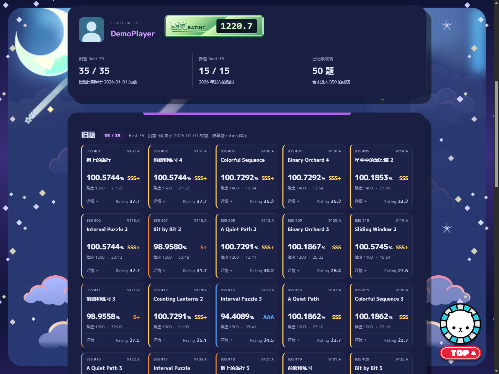
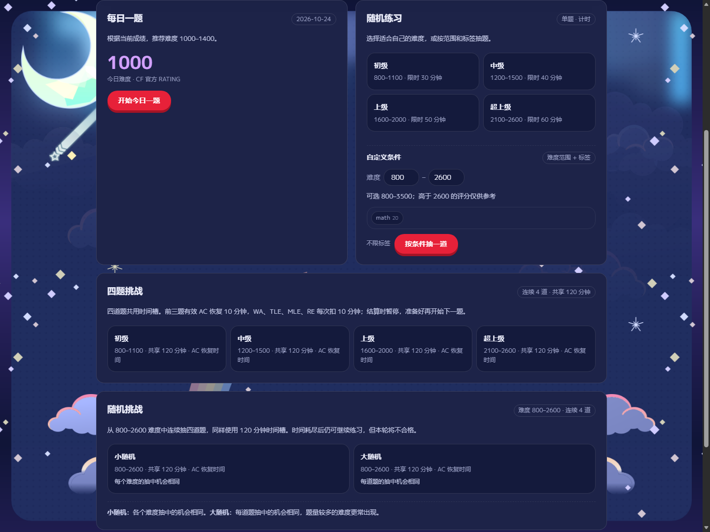
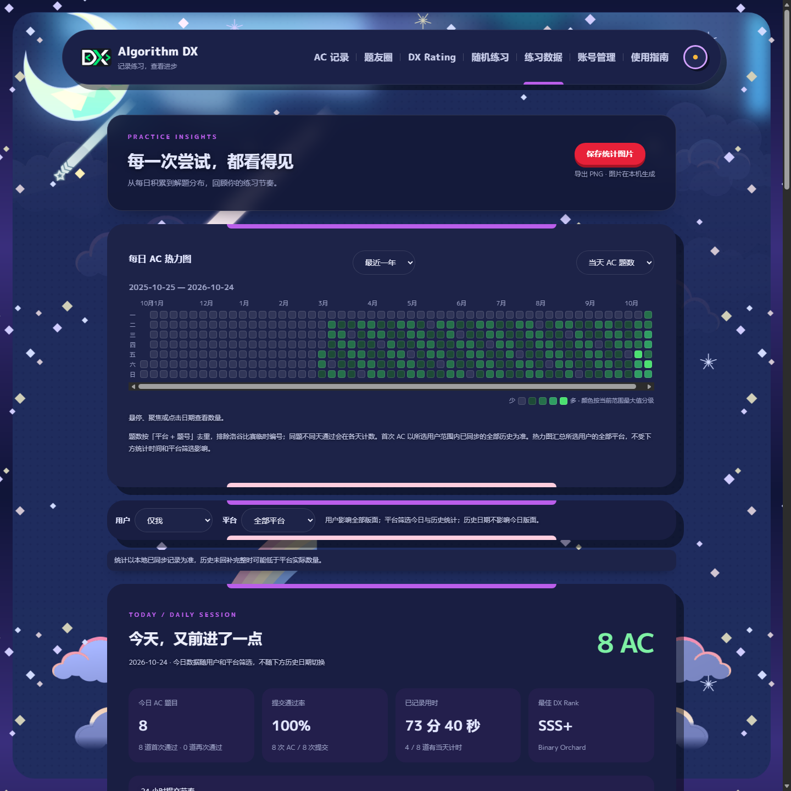
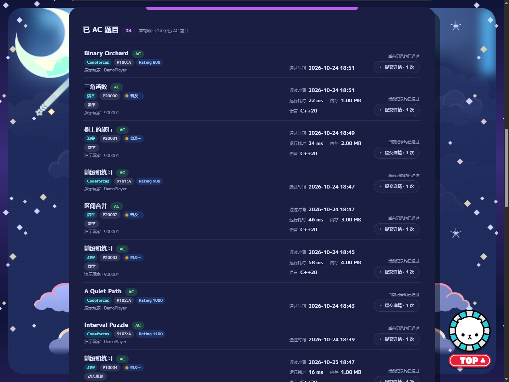
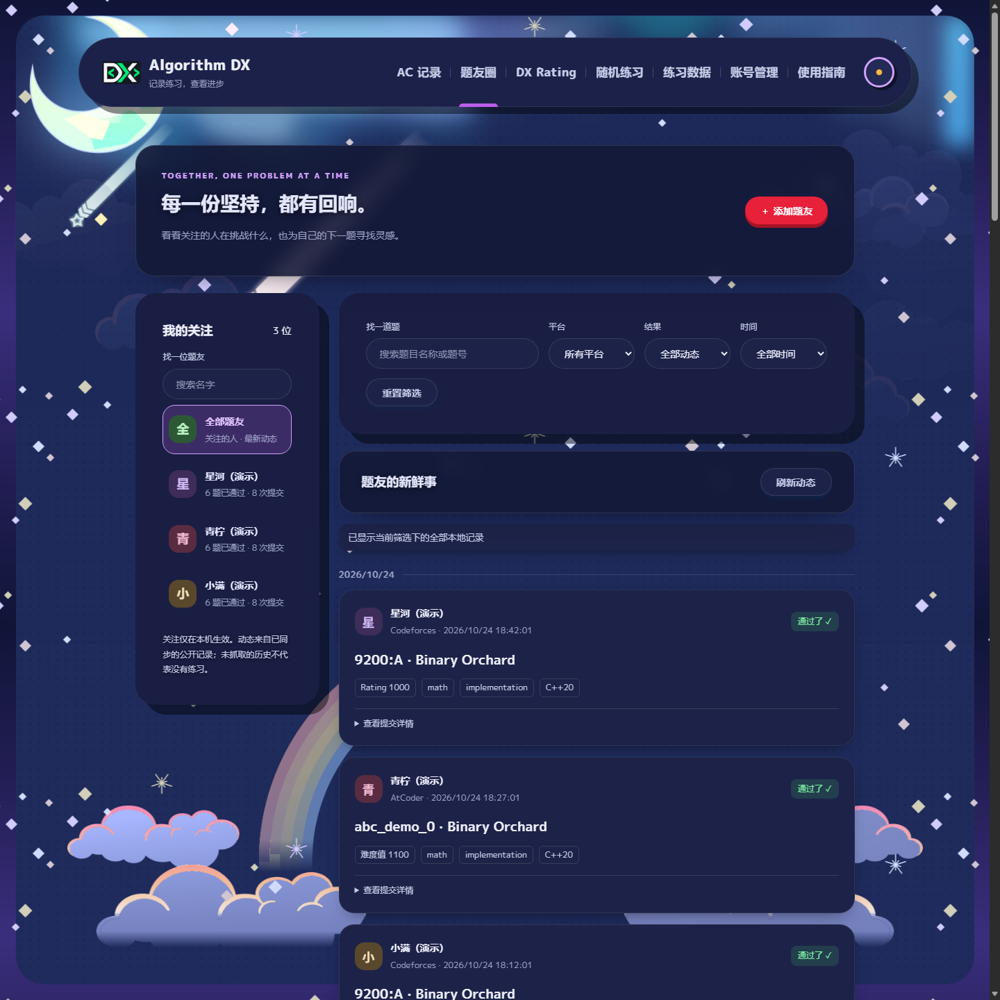
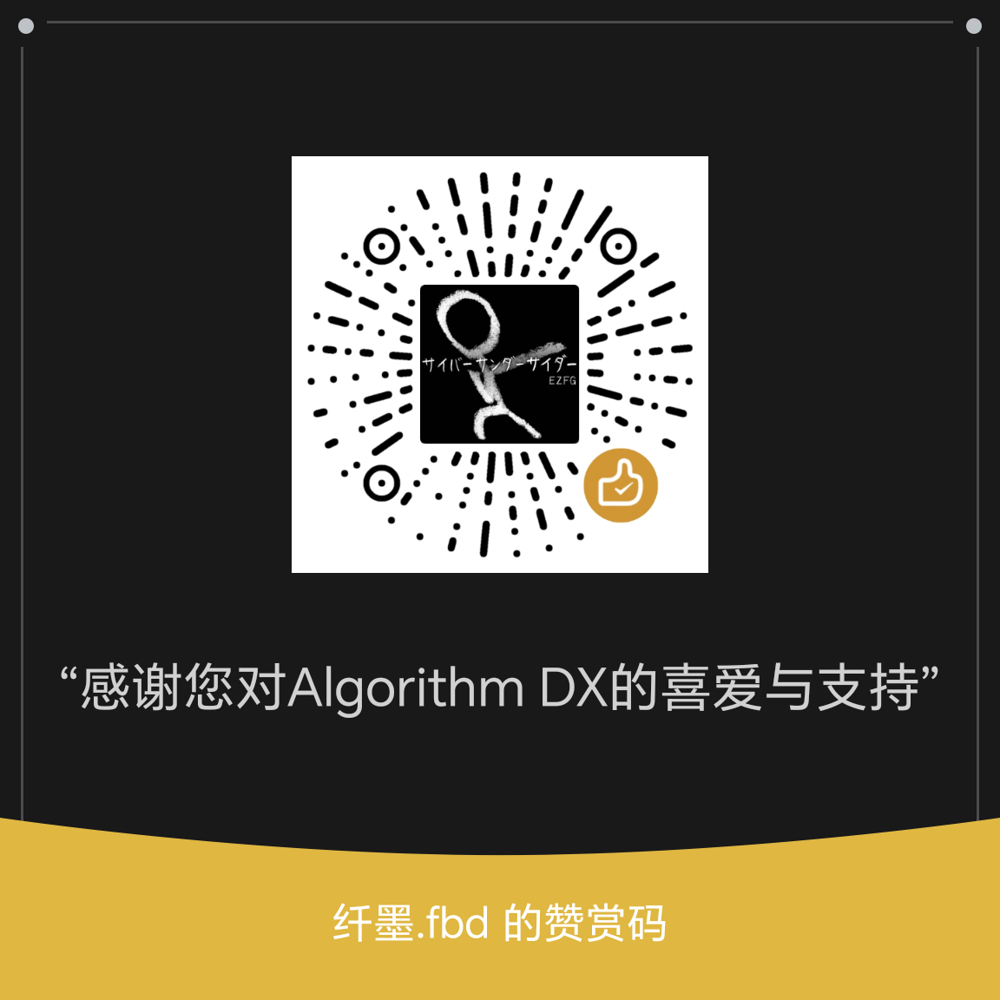

# Algorithm DX

[](https://github.com/fbd777/Algorithm-DX/actions/workflows/tests.yml)

受 maimai DX 启发的本地算法练习 Dashboard：汇总多平台做题记录，用 Codeforces 练习用时生成 B50 与 DX Rating，让每一次进步都看得见。

**官方 QQ 群：1131941735**。欢迎交流练习心得、反馈使用问题与功能建议。

[下载 v0.2.2（ZIP）](https://github.com/fbd777/Algorithm-DX/archive/refs/tags/v0.2.2.zip) · [版本说明](https://github.com/fbd777/Algorithm-DX/releases/tag/v0.2.2) · [Node.js 官方下载](https://nodejs.org/en/download) · [安装指南](docs/local-install.md) · [平台说明](docs/platforms.md) · [反馈问题](https://github.com/fbd777/Algorithm-DX/issues)

- **B50 与成绩结算**：计时练习、自动识别 AC、保存用时，查看达成率、评级与 DX Rating 变化。
- **多平台记录**：集中查看 AC 记录、题目与逐次练习历史。
- **练习数据**：年度热力图、今日时间线、提交趋势和题目分布。
- **题友圈**：关注题友，看看他们在不同平台的做题动态。
- **随机练习**：按难度档位、范围和标签抽题，或练习按当前水平推荐的每日一题。
- **本地优先**：数据保存在本地，启动新版自动迁移数据。

## v0.2.2 更新

- 全站采用统一的明暗主题，调整中文字体、导航和页面布局。
- B50 使用紧凑成绩卡，突出完成度和评级，单题 Rating 作为辅助信息；个人总 Rating 保留七种框体。
- 结算默认角色改为迪拉熊，重新整理判定、用时和 Rating 的排版。
- 四题挑战采用共享时间槽与独立用时，题目在新标签页打开，原页面保留倒计时。详细规则见[随机练习说明](docs/dan.md)。
- 更新使用指南，新增官方 QQ 群入口；启动时自动备份并升级旧数据库。

## 功能预览

以下为 v0.2.2 的界面截图，均使用**虚拟演示数据**，以深色模式为例。点击图片可查看原图。

| 计时与成绩结算 | B50 成绩总览 |
| --- | --- |
| [](docs/images/settlement-022.png) | [](docs/images/b50-022.png) |

| 随机练习与四题挑战 | 练习数据与今日练习 |
| --- | --- |
| [](docs/images/random-practice-022.png) | [](docs/images/practice-overview-022.png) |

| 多平台 AC 记录 | 题友圈 |
| --- | --- |
| [](docs/images/ac-records-022.png) | [](docs/images/friends-circle-022.png) |

## 下载与版本

- **首次使用**：[下载 v0.2.2 源码 ZIP](https://github.com/fbd777/Algorithm-DX/archive/refs/tags/v0.2.2.zip)，解压后按下方步骤启动。
- **版本记录**：[v0.2.2 发布说明](https://github.com/fbd777/Algorithm-DX/releases/tag/v0.2.2) · [全部版本](https://github.com/fbd777/Algorithm-DX/releases)。
- **最新改动**：[下载 main 分支 ZIP](https://github.com/fbd777/Algorithm-DX/archive/refs/heads/main.zip)，内容可能领先于发布版本。
- **运行环境**：[Node.js 官方下载](https://nodejs.org/en/download)，推荐选择 **24.x LTS 的最新补丁版本（24.22.1 或更新的 24.x 版本）**。Windows 用户选择对应架构的安装程序（通常为 x64 MSI），保留加入 PATH 的默认选项。

当前提供源码包，需先安装 Node.js。更新时保留 `.env`、`data/` 和自定义数据库；新版首次启动会自动备份并迁移旧库，保留已记录的做题用时，详见[更新说明](docs/local-install.md#更新移动和多份项目)。

## 快速开始

先从 [Node.js 官网](https://nodejs.org/en/download) 安装 **24.x LTS 的最新补丁版本（24.22.1 或更新的 24.x 版本）**，再下载项目。无需安装数据库服务，也无需运行 `npm install`。

已安装较早的 Node.js 24.x 时，建议先升级并重新启动项目。[24.22.1 安全更新说明](https://nodejs.org/en/blog/release/v24.22.1)。

### Windows

1. [下载 v0.2.2](https://github.com/fbd777/Algorithm-DX/archive/refs/tags/v0.2.2.zip) 并解压。
2. 打开解压后的文件夹，找到 `create-desktop-shortcut.cmd`（与 `README.md` 在同一层），双击运行。完成后，桌面会出现 **Algorithm DX** 快捷方式。
3. 双击桌面的 **Algorithm DX** 快捷方式启动程序并打开页面。首次启动会自动创建数据库和「我」用户。
4. 在页面「账号管理」绑定平台账号，按需配置登录态并同步。

创建快捷方式只需做一次，以后直接从桌面启动。若要移动项目文件夹，请删除旧快捷方式，再到新目录重新创建，也可直接双击 `dashboard.cmd`。运行时保持启动窗口开启，关闭窗口会停止服务。

### macOS / Linux / 终端

在解压后的项目根目录运行：

```sh
npm start
```

按终端显示的本机地址打开页面。有桌面环境时，可使用 `npm start -- --open` 自动打开浏览器。

更新、备份、迁移配置与常见问题见[本地安装指南](docs/local-install.md)。

## 支持的平台

**七个平台可汇总做题记录；DX 计分与 B50 目前仅支持 Codeforces。**

| 平台 | 登录要求 | 近期同步 | 历史回补 | DX / B50 |
| --- | --- | --- | --- | --- |
| Codeforces | 公开记录，无需登录 | 各类判题结果 | 支持公开历史 | 支持¹ |
| LeetCode 国际站 | 无需登录 | 最多 20 条公开提交 | 不支持 | 不支持 |
| 力扣中国站 | 回补需要Cookie | 最多 20 条公开 AC | 支持本人可见历史² | 不支持 |
| AtCoder | 无需登录 | 镜像中的提交记录 | 支持镜像可见历史 | 不支持 |
| 洛谷 | 需要Cookie | 登录态可见记录 | 支持可见历史 | 不支持 |
| 码蹄集 | 需要Cookie | 登录态可见记录 | 支持可见历史³ | 不支持 |
| 牛客 | 公开记录无需登录 | 编程练习提交 | 支持公开编程历史 | 不支持 |

¹ Codeforces 计分需有效 AC 用时与题目评级；Group 比赛需单独配置登录读取或授权 API。

² 力扣中国站回补含失败提交、不含源码，仅限 Cookie 本人；当前有模拟测试覆盖，尚未完成真实登录态验证。

³ 码蹄集已实测账号识别、近期同步和可见历史回补；较大账号的跨页真实验证仍有限，另提供 JSON 备用导入。

AtCoder 数据来自 AtCoder Problems 第三方镜像，可能延迟或缺失；牛客不包含选择题。**支持回补不等于保证全部历史完整**，统计始终以本地已同步记录为准。

账号怎么填写、Cookie 配置和各平台限制见[平台接入清单](docs/platforms.md#接入清单)。

## B50 怎么计算

- 根据 Codeforces 题目难度与有效练习用时，计算单题达成率、评级和 Rating。
- 取旧题中表现最佳的 **35 道**，加上当前年度新题中表现最佳的 **15 道**。
- 年度自动读取运行程序的电脑**当前系统年份**，无需选择；跨年后重新读取榜单，上年度新题归入旧题区。
- 新旧题按**出题年份**划分，不按 AC 日期划分；未计时或缺少题目评级的记录暂不计分。

DX Rating 是本项目的娱乐向练习指标，评分模型及外推范围见[计分说明](docs/dx-rating.md)。

## 数据与隐私

数据默认保存在 `data/algorithm-dx.sqlite`，配置与平台凭据保存在本机。项目没有云账号、云同步或遥测，HTTP 服务仅监听 `127.0.0.1`。

**打开页面时可能触发自动同步**；自动或手动同步会访问对应平台。凭据只用于对应平台的数据读取，请勿提交 `.env` 或个人数据库到仓库。

## 文档与开发

- [本地安装、桌面快捷方式与更新](docs/local-install.md)
- [平台接入与数据边界](docs/platforms.md)
- [DX Rating 与 B50 计分说明](docs/dx-rating.md)
- [练习历史与离线回测](docs/backtesting.md)
- [随机练习与四题挑战](docs/dan.md)
- [目录、数据模型与 API](docs/development.md)
- [Codeforces × maimai 统计实验](docs/cf-maimai-study.md)

技术栈：Node.js / TypeScript / SQLite / 原生 HTML、CSS、JavaScript。运行测试：`npm test`。提交到 main 或向 main 发起 Pull Request 时，GitHub Actions 会在 Windows、macOS 和 Linux 上运行测试；另在 Linux 检查最新 Node.js 24.x。也可在 Actions 页面手动运行。欢迎反馈问题和提交 Pull Request。

项目采用 [MIT 许可证](LICENSE)，允许使用、修改与分发；是否合并贡献由维护者决定。

## 支持项目

如果 Algorithm DX 对你有帮助，点个 Star、反馈问题或分享给朋友，都是对本项目的支持。

<details>
<summary>自愿赞赏 · 支持后续维护与更新</summary>

感谢你的使用与支持。

<a href="public/support-code.png"></a>

</details>
